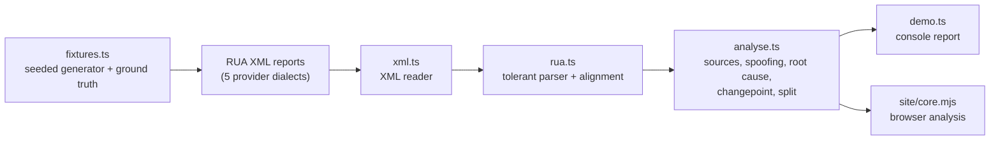

# dmarcwatch

Deliverability monitoring from DMARC aggregate (RUA) reports, separating "the mail never arrived" from "the mail arrived and was ignored".

[](https://github.com/SlateGitOrg/dmarcwatch/actions/workflows/ci.yml)
[Live demo](https://slategitorg.github.io/dmarcwatch/)


## Why

When a subdomain's authentication breaks or a third-party sender starts failing DMARC, a share of your mail stops being delivered. Open rates fall, the team A/B-tests subject lines for weeks, and nothing in an engagement dashboard can show that the real cause is authentication. DMARC aggregate reports, which any domain owner gets for free after one DNS record change, contain the evidence. dmarcwatch uses it to attribute an open-rate drop to deliverability or to engagement, and to name the misconfiguration behind it.

## Features

- RUA XML ingestion with a dependency-free reader that tolerates provider schema variance (namespaces, CDATA, entities, element order, Title-Case results, swapped date ranges, repeated DKIM blocks).
- SPF / DKIM / DMARC pass-rate tracking per sending source and per subdomain, with a changepoint detector and a two-proportion significance test.
- Root-cause diagnosis of alignment failures (`spf-alignment`, `dkim-absent`, and others) rather than a bare "DMARC failed".
- Unauthorised-sender detection using a robust z-score, with volume and geography, that does not alert on forwarder noise.
- Deliverability-versus-engagement split: the open-rate change decomposed into two parts that sum exactly to the observed change.
- A seeded five-dialect corpus generator with planted faults and ground truth, and a browser version of the analysis in `site/`.

## Architecture



Reports are parsed into a normalised model, flattened into observations, and analysed in memory. See [docs/ARCHITECTURE.md](docs/ARCHITECTURE.md) for decisions and failure modes.

## Quick start

Requirements: Node 22.6+ (24 recommended). TypeScript runs through Node's type stripping, so there is no build step and no `npm install`. On Node 22 add `NODE_OPTIONS=--experimental-strip-types`; on Node 24 it is on by default.

```bash
git clone https://github.com/SlateGitOrg/dmarcwatch.git
cd dmarcwatch
node --test          # run the test suite (same as: npm test)
node src/demo.ts     # print the console report (same as: npm run demo)
```

## Usage

`node src/demo.ts` builds a 29-day synthetic corpus (seed 20260310) and prints the analysis. Trimmed output:

```
domain            : insurer-example.com
RUA documents     : 145 from 5 providers
records / messages: 1,252 rows, 520,302 messages
parse warnings    : 0

changepoint       : 2026-03-10  (planted: 2026-03-10)
DMARC pass rate   : 100.0% before -> 15.0% after
two-proportion z  : 506.7   significant: YES

spf-alignment                154,842 msgs
  SPF passed for bounce.acme-esp.net but that does not align with header_from mail.insurer-example.com ...

NAIVE VIEW (open rate over messages sent):  24.0% -> 3.6%  (-20.4 points)
DMARC-AWARE VIEW (open rate over delivered): 24.0% -> 24.0%
VERDICT        : DELIVERABILITY
```

## How it works

| What | Measured on the seeded corpus |
|---|---|
| Break day found in `mail.` subdomain pass rate | 2026-03-10 (planted 2026-03-10), 100.0% -> 15.0%, z = 506.7 |
| Root cause named | `spf-alignment` (SPF passes for an unaligned `bounce.` domain) plus `dkim-absent`, 154,842 msgs |
| Open rate over sent | 24.0% -> 3.6% (-20.38 points); the naive reading blames subject lines |
| Open rate over delivered | 24.0% -> 24.0% (planted truth 24.0%) |
| Split of the drop | -20.39 points deliverability, +0.01 points engagement |
| Unauthorised senders | 1 of 1 planted spoofer flagged; a new vendor with valid DKIM and 5 forwarder IPs not flagged, where alerting on every unfamiliar IP raises 6 false alarms |
| Broken DKIM on `claims.` with SPF passing | 52,434 delivered, 0 blocked: a hygiene warning, not an incident |

Design notes:

- The "is this change real?" threshold uses the standard error of the difference between two rates at 1.96. Using a single rate's error called noise an engagement drop on a no-change control.
- Quarantined and rejected mail counts as never arrived, so open rate is computed over delivered mail only.
- Spoofing needs at least 4 unfamiliar sources with no alignment evidence; with fewer it flags nothing rather than invent a volume cut-off.

## Testing

```bash
node --test
```

Runs 41 `node:test` cases in about a second: XML reader edge cases, parsing across the five provider dialects including malformed input, root-cause classification for each planted fault, spoofing detection and false-alarm checks, the exact decomposition of the open-rate change, and the browser logic in `site/core.test.mjs`. CI also validates the Pages site.

## Project layout

```
src/xml.ts        dependency-free XML reader (namespaces, CDATA, entities)
src/rua.ts        RUA report model, tolerant multi-dialect reader, alignment
src/analyse.ts    sources, spoofing detection, root cause, changepoint, the split
src/fixtures.ts   seeded five-dialect generator with planted faults + ground truth
src/demo.ts       console report
site/             browser version of the analysis (GitHub Pages)
tests/            node:test suites
docs/             architecture notes and screenshots
```

## Limitations

- Synthetic data only: the dialects copy real variance, but no real provider report is included.
- Quarantined mail counts as never arrived; some spam-folder mail is opened, so the deliverability share is an upper bound.
- `pct` < 100 sampling is parsed but not modelled, and neither are mailbox-provider policy overrides.
- The organisational-domain lookup uses a small built-in suffix table, not the Public Suffix List.
- Geography comes from a fixed table, not GeoIP. There is no persistence, ingest command or dashboard; the demo builds its corpus in memory.
- Not an email-sending platform; it monitors what yours is doing.

## License

MIT — see [LICENSE](LICENSE).
