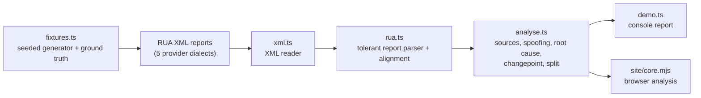

# Architecture

## Context

Email performance collapses quietly when a subdomain's SPF/DKIM alignment
breaks or a third-party sender starts failing DMARC. Engagement dashboards
(opens, clicks) cannot tell "the message never arrived" from "the message
arrived and was ignored", so teams spend weeks testing subject lines for a
problem that is really authentication. dmarcwatch reads DMARC aggregate (RUA)
reports, which any domain owner receives for free, and uses them to split an
open-rate movement into a deliverability part and an engagement part.

## Container view

Everything runs in memory with no dependencies. `src/` is the TypeScript
reference (Node type stripping); `site/` is a browser version of the decision
logic published to GitHub Pages.

## Key decisions

- **Denominator matters.** Mail that failed DMARC under a quarantine or reject
  policy never reached the inbox, so its engagement is missing rather than low.
  Open rate is computed over delivered mail, and the observed change is split
  exactly into a deliverability term and an engagement term that sum to it.
- **Two-proportion test for the break day.** The changepoint uses the standard
  error of the difference between two rates (1.96, two-sided 5%), not the error
  of a single rate, which called noise a real drop on a no-change control.
- **Root cause, not just failure.** Failures are classified (`spf-alignment`,
  `dkim-absent`, ...) because the cause is what makes the report actionable.
- **Spoofing is separated from noise.** A robust z-score over the volume of
  unaligned sources avoids alerting on every unfamiliar forwarder IP, and
  sources with an aligned DKIM signature are treated as an inventory gap.
- **Tolerant parsing.** The reader handles element order, Title-Case results,
  namespace prefixes, CDATA, swapped date ranges and repeated DKIM blocks.

## Failure modes

- Malformed or truncated XML is reported as a parse warning rather than
  silently dropped.
- With fewer than 4 unfamiliar unaligned sources the spoofing test flags
  nothing instead of inventing a volume cut-off.
- Domains under suffixes missing from the built-in table can be merged into one
  organisational domain.

## Out of scope

Sending email, persistence, a GeoIP lookup, and modelling `pct` sampling or
mailbox-provider policy overrides.
